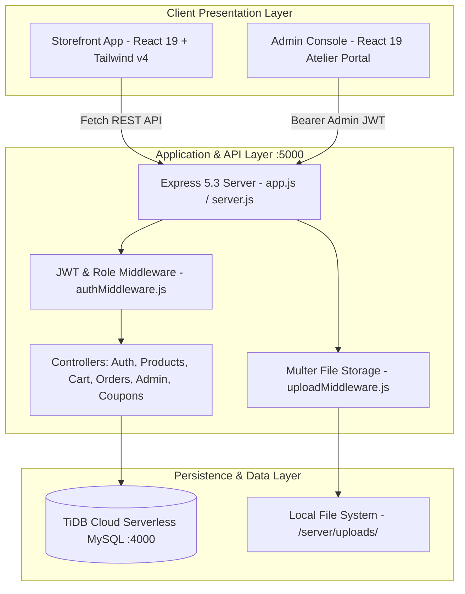
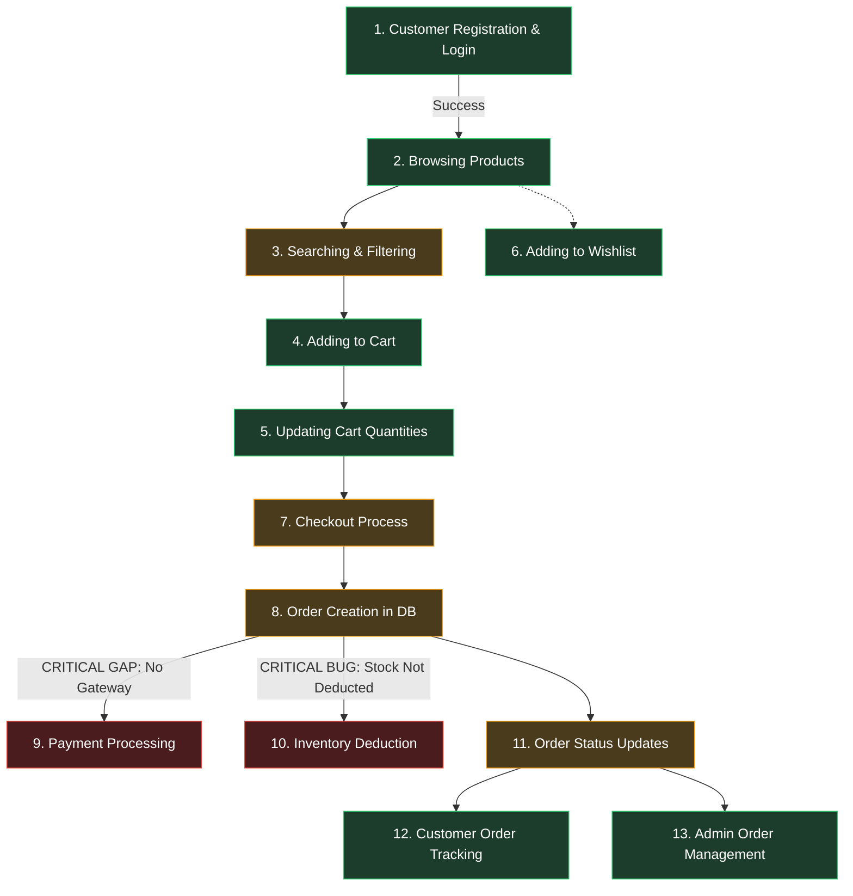
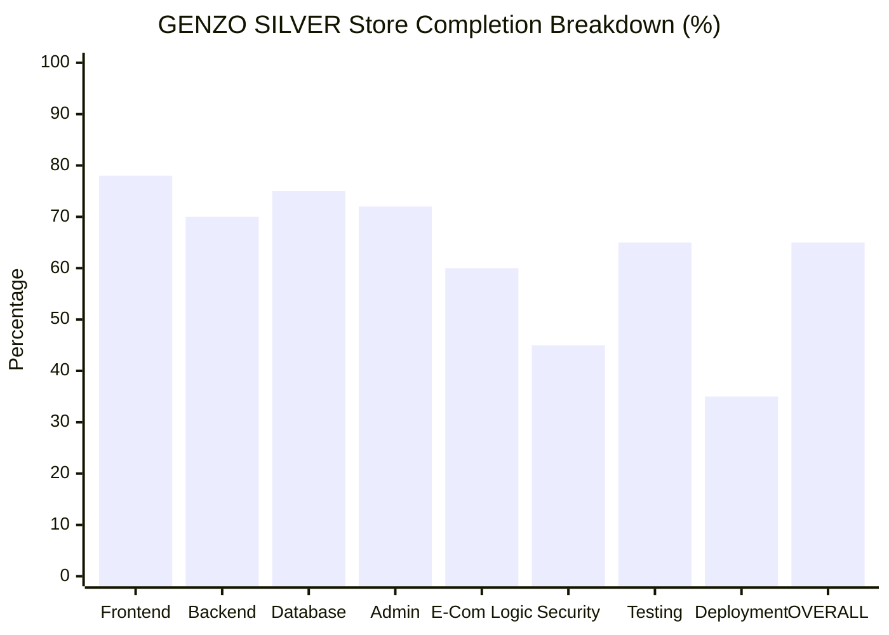
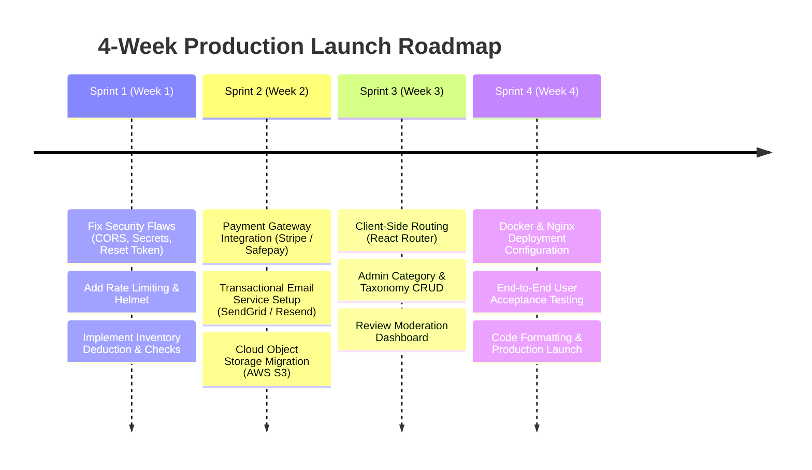

# GENZO SILVER Store — Complete Technical Audit & Production Readiness Report

**Project Name:** GENZO SILVER Store (Certified 925 Sterling Silver Luxury E-Commerce Platform)  
**Audit Date:** November 2026  
**Auditor Roles:** Senior Full-Stack Software Architect, QA Engineer, Backend Developer, Frontend Developer, DevOps Engineer  
**Codebase Working Directory:** `c:\Users\Rohan C\Downloads\Build GENZO SILVER Store`  
**Active Database:** TiDB Cloud Serverless (AWS Tokyo `gateway01.ap-northeast-1.prod.aws.tidbcloud.com:4000`)  
**Backend API Server:** Node.js / Express 5.3 (`http://localhost:5000`)  
**Storefront Client:** React 19 + TypeScript + Tailwind CSS v4 + Framer Motion  
**Admin Atelier Portal:** React 19 + Vite (`admin/`)  

---

## 1. Executive Summary

A comprehensive, ground-up technical inspection of the **GENZO SILVER Store** e-commerce platform was conducted across the storefront frontend, admin console, Express REST API backend, TiDB Cloud database instance, authentication system, checkout pipeline, asset handling, security posture, and production build tooling.

### Key Audit Findings:
1. **Visual Design & User Experience:** The visual aesthetics, typography, animations, responsive design, and luxury branding of the storefront are exceptional. The storefront renders a sophisticated jewelry atelier experience.
2. **Database & Core APIs:** The database connection to TiDB Cloud is live and operational with 17 structured tables. Core REST endpoints for product cataloging, reviews, shopping bag, wishlist, coupon codes, and basic order creation are functional.
3. **Critical Showstopper Deficiencies:**
   - **No Inventory Deduction:** When orders are created via `POST /api/v1/orders`, **zero stock deduction occurs** in either `products` or `product_sizes`. Out-of-stock items can be purchased freely, leading to guaranteed overselling in production.
   - **No Automated Payment Gateway:** Card payments are purely cosmetic without any integrated payment gateway (e.g., Stripe, Safepay, PayFast, 2Checkout). JazzCash, Easypaisa, and Bank Transfer rely entirely on manual bank transfer receipts uploaded as image files.
   - **Severe Password Reset Vulnerability:** The `POST /api/v1/auth/forgot-password` endpoint generates a reset code and **returns it directly inside the JSON response**, enabling any unauthorized user to hijack any account without inbox access.
   - **Absence of Transactional Emails:** No mailer service (Nodemailer, SendGrid, Resend, AWS SES) is configured. Order confirmation receipts, tracking notices, and password recovery emails are never delivered to customers.
   - **Security Vulnerabilities:** Hardcoded fallback database credentials and JWT secret strings exist in backend source files; CORS allows arbitrary origins with credentials enabled; and no rate limiting is enforced on login, registration, or checkout endpoints.
   - **Monolithic State-Based Navigation:** The storefront relies on internal React state (`page = "home" | "collection" | ...`) rather than standard client-side routing (React Router), meaning URL reloading resets the view, direct links cannot be bookmarked or shared, and browser back/forward buttons do not function.

---

## 2. Project Architecture Overview

### Architectural Stack
- **Storefront Client:** React 19, TypeScript 5.7, Tailwind CSS v4 (`@tailwindcss/vite`), Framer Motion 14, Lucide React icons.
- **Admin Portal:** React 19, Vite 8, Tailwind CSS v4, Lucide React icons (`admin/`).
- **Backend API:** Node.js, Express 5.3, MySQL2 (`mysql2/promise`), Multer 2.5, JWT (`jsonwebtoken`), Bcryptjs 3.0.
- **Database:** TiDB Cloud Serverless (MySQL 8.0 wire-compatible, SSL/TLS 1.2 required, Port 4000).
- **Asset Storage:** Local filesystem storage (`server/uploads/receipts` and `server/uploads/products`).

### High-Level System Architecture Diagram


---

## 3. Frontend Completion Audit

### 3.1 Feature-by-Feature Status Matrix

| Screen / Feature | Implementation Status | Verification Notes |
| :--- | :---: | :--- |
| **Homepage** | Complete | Hero editorial banner, New Icons collection showcase, atelier values, craft story, and newsletter subscription form verified. |
| **Header & Navbar** | Complete | Logo, category anchors, desktop/mobile navigation drawers, active bag badge counter, and wishlist counter verified. |
| **Footer** | Complete | Studio hours, brand manifesto, concierge contacts, policy modal triggers, newsletter form, and copyright verified. |
| **Product Listing (Collection)** | Complete | [CollectionPage.tsx](file:///c:/Users/Rohan%20C/Downloads/Build%20GENZO%20SILVER%20Store/src/components/CollectionPage.tsx) renders 2x2 and 3x3 grids, badge badges, prices, and filter sidebar. |
| **Product Details (PDP)** | Complete | [ProductDetailPage](file:///c:/Users/Rohan%20C/Downloads/Build%20GENZO%20SILVER%20Store/src/App.tsx#L58-L339) features multi-image gallery thumbnail switcher, size selector, quantity adjuster, editorial accordions, and reviews section. |
| **Product Categories** | Partially Complete | Categories ("Men", "Women", "Unisex") work in UI filtering, but are hardcoded to 3 seeded categories with no dynamic category page routes. |
| **Product Search** | Partially Complete | Search input in navbar and collection page filters products in-memory on the client; does not paginate server-side queries. |
| **Filters & Sorting** | Partially Complete | Filter by category, type, finish, price preset, and badges verified in-memory. Does not leverage backend query params during browsing. |
| **Shopping Cart** | Complete | [WishlistDrawer](file:///c:/Users/Rohan%20C/Downloads/Build%20GENZO%20SILVER%20Store/src/components/WishlistDrawer.tsx) & slide-over Cart Drawer handle line items, quantity increment/decrement, line removal, free shipping bar (PKR 25,000 threshold), and gift packaging request. |
| **Wishlist** | Complete | Slide-out dedicated [WishlistDrawer.tsx](file:///c:/Users/Rohan%20C/Downloads/Build%20GENZO%20SILVER%20Store/src/components/WishlistDrawer.tsx), header counter, "Move to Bag", and "Remove" actions functional. |
| **Checkout Flow** | Partially Complete | [CheckoutPage](file:///c:/Users/Rohan%20C/Downloads/Build%20GENZO%20SILVER%20Store/src/App.tsx#L340-L847) supports contact details, delivery address, COD, voucher codes, and manual receipt upload. Card checkout is non-functional. |
| **User Registration** | Complete | Account modal registers users, hashes passwords, sets JWT, and loads customer account view. |
| **User Login** | Complete | Authenticates against `POST /api/v1/auth/login`, persists JWT in `localStorage`, and restores session on page load. |
| **User Profile** | Complete | Customer account displays membership tier, phone number, and allows name/phone/password updates via `PUT /api/v1/auth/me`. |
| **Order History** | Complete | Fetches authenticated customer orders via `GET /api/v1/orders/my-orders`, displays line item breakdown, and provides printable invoice view. |
| **Ring Size Guide** | Complete | [RingSizeGuideModal.tsx](file:///c:/Users/Rohan%20C/Downloads/Build%20GENZO%20SILVER%20Store/src/components/RingSizeGuideModal.tsx) provides international conversion table (circumference, diameter, US, UK, PK sizes) and measurement instructions. |
| **Customer Reviews** | Complete | [ProductReviewsSection.tsx](file:///c:/Users/Rohan%20C/Downloads/Build%20GENZO%20SILVER%20Store/src/components/ProductReviewsSection.tsx) loads live customer reviews from DB and submits reviews via modal. ProductCard displays hardcoded `★ 5.0`. |
| **Policy Modals** | Complete | [PolicyModals.tsx](file:///c:/Users/Rohan%20C/Downloads/Build%20GENZO%20SILVER%20Store/src/components/PolicyModals.tsx) provides dedicated slide-over modals for Shipping & 7-Day Returns, 925 Silver Care Guide, Privacy/Terms, and FAQs. |
| **Order Tracking** | Complete | Visual 5-stage tracking pipeline (Placed -> Verified -> Crafting -> Dispatched -> Delivered) lookups verified against DB. |
| **Client-Side Routing** | Broken / Missing | No `react-router-dom`. Uses `useState<Page>("home")`. Page reloads reset state to Home, no deep-links for products exist, and browser navigation buttons fail. |
| **State Management** | Partially Complete | [useAuthStore.ts](file:///c:/Users/Rohan%20C/Downloads/Build%20GENZO%20SILVER%20Store/src/stores/useAuthStore.ts) is an unreferenced orphan file with a response mapping defect. `App.tsx` manages all global state via local `useState`. |

---

## 4. Backend Completion Audit

### 4.1 Server Configuration & Routing Architecture
- The backend server is initialized in [server.js](file:///c:/Users/Rohan%20C/Downloads/Build%20GENZO%20SILVER%20Store/server/server.js) and configures Express in [app.js](file:///c:/Users/Rohan%20C/Downloads/Build%20GENZO%20SILVER%20Store/server/src/app.js).
- All endpoints are scoped under `/api/v1` and segregated into domain routers: `productRoutes.js`, `authRoutes.js`, `cartRoutes.js`, `wishlistRoutes.js`, `orderRoutes.js`, `newsletterRoutes.js`, `contactRoutes.js`, and `adminRoutes.js`.

### 4.2 Endpoint Inspection & Verification Status

| Endpoint | Method | Auth Required | Status | Notes |
| :--- | :---: | :---: | :---: | :--- |
| `/api/health` | GET | None | Verified | Returns healthy status, service name, and TiDB database indicator. |
| `/api/v1/products` | GET | None | Verified | Dynamic filtering by category, types, finishes, badges, search, price presets, and pagination. |
| `/api/v1/products/featured` | GET | None | Verified | Fetches up to 8 featured/bestseller pieces for homepage. |
| `/api/v1/products/facets` | GET | None | Verified | Aggregates count of products per category, type, finish, badge, and min/max prices. |
| `/api/v1/products/:idOrSlug` | GET | None | Verified | Returns product info, sizes array, gallery images array, and editorial accordions. |
| `/api/v1/products/:id/reviews` | GET | None | Verified | Returns customer reviews, average rating calculation, and total review count. |
| `/api/v1/products/:id/reviews` | POST | Optional | Verified | Creates review in `product_reviews`. Hardcodes `verified_purchase = true` without validation. |
| `/api/v1/auth/signup` | POST | None | Verified | Validates payload, hashes password with bcrypt (10 rounds), generates JWT. |
| `/api/v1/auth/login` | POST | None | Verified | Validates email/password, compares bcrypt hash, returns JWT token and user profile. |
| `/api/v1/auth/me` | GET | Bearer Token | Verified | Returns authenticated user profile from database. |
| `/api/v1/auth/me` | PUT | Bearer Token | Verified | Updates full name, phone number, and optionally updates password with verification. |
| `/api/v1/auth/forgot-password` | POST | None | Broken (Insecure) | Generates reset code, updates DB, but **leaks reset code in response JSON**; sends no email. |
| `/api/v1/auth/reset-password` | POST | None | Verified | Validates code against `reset_token_expires`, hashes new password, clears token. |
| `/api/v1/cart` | GET | Session / User | Verified | Retrieves cart line items joined with product table, returns subtotal and shipping. |
| `/api/v1/cart` | POST | Session / User | Verified | Adds item or increments existing line quantity. Validates `in_stock`. |
| `/api/v1/cart/:cartItemId` | PATCH | Session / User | Verified | Updates line quantity by delta or absolute value; deletes if quantity <= 0. |
| `/api/v1/cart/:cartItemId` | DELETE | Session / User | Verified | Deletes line item from `cart_items`. |
| `/api/v1/cart` | DELETE | Session / User | Verified | Clears all items for user or session. |
| `/api/v1/wishlist` | GET | Session / User | Verified | Retrieves user or guest session wishlist items. |
| `/api/v1/wishlist/toggle` | POST | Session / User | Verified | Toggles product presence in `wishlist_items`. |
| `/api/v1/orders` | POST | Session / User | Broken (Logic) | Inserts order and line items inside transaction, **but fails to deduct inventory**. |
| `/api/v1/orders/:orderId/receipt` | POST | None / Token | Verified | Multer saves receipt to `server/uploads/receipts/` and updates `receipt_url` in order. |
| `/api/v1/orders/track` | GET | None | Verified | Queries order by `orderNumber` and optional phone/email, returning line items and status. |
| `/api/v1/orders/my-orders` | GET | Bearer Token | Verified | Returns authenticated user's order history with line items. Contains N+1 query loop. |
| `/api/v1/orders/validate-coupon` | POST | None | Verified | Validates promo code, checks expiry and minimum spend, returns discount calculation. |
| `/api/v1/contact` | POST | None | Verified | Records client inquiry in `inquiries` table. |
| `/api/v1/contact/settings` | GET | None | Verified | Fetches store configuration settings from `store_settings` table. |
| `/api/v1/newsletter/subscribe` | POST | None | Verified | Adds or reactivates subscriber in `newsletter_subscribers`. |
| `/api/v1/admin/stats` | GET | Admin Token | Verified | Calculates real revenue, orders count, low stock counts, 7-day sales, and top sellers. |
| `/api/v1/admin/orders` | GET | Admin Token | Verified | Lists all orders with search, status filters, line items, and summary counters. |
| `/api/v1/admin/orders/:id` | PATCH | Admin Token | Verified | Updates order status, payment status, and tracking code. |
| `/api/v1/admin/orders/:id` | DELETE | Admin Token | Verified | Cascades order deletion in transaction. |
| `/api/v1/admin/products` | GET | Admin Token | Verified | Paginated product listing including out-of-stock items for atelier manager. |
| `/api/v1/admin/products` | POST | Admin Token | Verified | Creates new product, slug, sizes, images, and accordions inside transaction. |
| `/api/v1/admin/products/:id` | PUT / PATCH | Admin Token | Verified | Updates product attributes and stock attributes. |
| `/api/v1/admin/products/:id` | DELETE | Admin Token | Verified | Cascades product deletion from database. |
| `/api/v1/admin/products/:id/toggle-stock` | PATCH | Admin Token | Verified | Toggles `in_stock` boolean flag. |
| `/api/v1/admin/upload-product-image` | POST | Admin Token | Verified | Multer uploads file to `server/uploads/products/` and returns URL. |
| `/api/v1/admin/coupons` | GET / POST / DELETE | Admin Token | Verified | Full CRUD management of promotional codes in `coupons` table. |
| `/api/v1/admin/customers` | GET | Admin Token | Verified | Returns registered users with total spent and completed orders count. |
| `/api/v1/admin/subscribers` | GET | Admin Token | Verified | Returns newsletter subscribers list. |
| `/api/v1/admin/inquiries` | GET / PATCH | Admin Token | Verified | Reads customer inquiries and allows status updates (`in_progress`, `resolved`). |
| `/api/v1/admin/settings` | GET / PUT | Admin Token | Verified | Reads and updates configuration in `store_settings` table. |
| `/api/v1/admin/categories` | ANY | Admin Token | Not Implemented | **No routes exist** for category or product type CRUD. |

---

## 5. Database Audit

### 5.1 Connection & Engine
- **Host:** TiDB Cloud Serverless (`gateway01.ap-northeast-1.prod.aws.tidbcloud.com`)
- **Port:** 4000 (MySQL wire protocol)
- **SSL:** TLS 1.2 required (`rejectUnauthorized: true`)
- **Character Set:** `utf8mb4`, Collation: `utf8mb4_unicode_ci`

### 5.2 Database Table Inventory & Row Counts
Verified live row counts from TiDB Cloud:

| Table Name | Row Count | Primary Key | Foreign Keys / Cascades |
| :--- | :---: | :---: | :--- |
| `store_settings` | 7 | `id` (INT) | None |
| `users` | 3 | `id` (INT) | None |
| `categories` | 3 | `id` (INT) | Referenced by `products.category_id` (RESTRICT) |
| `product_types` | 5 | `id` (INT) | Referenced by `products.type_id` (RESTRICT) |
| `product_finishes` | 4 | `id` (INT) | Referenced by `products.finish_id` (RESTRICT) |
| `products` | 18 | `id` (INT) | `category_id`, `type_id`, `finish_id` |
| `product_images` | 54 | `id` (INT) | `product_id` -> `products(id)` ON DELETE CASCADE |
| `product_sizes` | 36 | `id` (INT) | `product_id` -> `products(id)` ON DELETE CASCADE |
| `product_accordions` | 54 | `id` (INT) | `product_id` -> `products(id)` ON DELETE CASCADE |
| `cart_items` | 0 | `id` (INT) | `user_id` -> `users(id)`, `product_id` -> `products(id)` ON DELETE CASCADE |
| `wishlist_items` | 2 | `id` (INT) | `user_id` -> `users(id)`, `product_id` -> `products(id)` ON DELETE CASCADE |
| `orders` | 6 | `id` (INT) | `user_id` -> `users(id)` ON DELETE SET NULL |
| `order_items` | 6 | `id` (INT) | `order_id` -> `orders(id)` ON DELETE CASCADE |
| `newsletter_subscribers` | 3 | `id` (INT) | None |
| `inquiries` | 1 | `id` (INT) | None |
| `coupons` | 3 | `id` (INT) | None |
| `product_reviews` | 7 | `id` (INT) | **Missing foreign key** to `products(id)` and `users(id)` |

### 5.3 Database Deficiencies & Architectural Flaws
1. **Missing Foreign Key on `product_reviews`:** The `product_reviews` table contains `product_id` and `user_id` columns, but neither has an enforced Foreign Key constraint. Deleting a product or user leaves orphaned reviews in the database.
2. **Missing Review Moderation Column:** `product_reviews` has no `is_approved` or `status` flag. All submitted reviews immediately appear live on the storefront.
3. **Missing `user_addresses` Table:** Customers cannot save multiple shipping or billing addresses in an address book. Every checkout order requires re-entering the complete street address.
4. **Missing Dedicated `payments` / `transactions` Table:** Payment data is compressed into basic columns on the `orders` table (`payment_method`, `payment_status`, `receipt_url`). There is no ledger for transaction reference IDs, gateway payloads, retry logs, or refunds.
5. **N+1 Query Performance Pattern:** In both [orderController.js](file:///c:/Users/Rohan%20C/Downloads/Build%20GENZO%20SILVER%20Store/server/src/controllers/orderController.js#L373) (`getMyOrders`) and [adminController.js](file:///c:/Users/Rohan%20C/Downloads/Build%20GENZO%20SILVER%20Store/server/src/controllers/adminController.js#L182) (`getAllOrders`), orders are queried, and then line items are resolved via individual `SELECT` queries inside loops. This degrades performance as order volume scales.

---

## 6. Admin Dashboard Audit

### 6.1 Functionality Verification
The Admin Console located in [admin/src](file:///c:/Users/Rohan%20C/Downloads/Build%20GENZO%20SILVER%20Store/admin/src) was tested for operational integrity:

| Admin Feature | Real DB or Dummy? | Verified Status | Audit Analysis |
| :--- | :---: | :---: | :--- |
| **Admin Login** | Real DB | Verified | Authenticates using admin credentials, enforces `role === 'admin'`, stores token in `localStorage`. |
| **Overview Metrics** | Real DB | Verified | Computes total revenue (sum of verified/confirmed orders), total orders, total customers, low stock count. |
| **7-Day Sales Trend Chart** | Real DB | Verified | Visual bar chart grouping orders and revenue from the last 7 calendar days directly via SQL query. |
| **Top-Selling Leaderboard** | Real DB | Verified | Identifies top 5 jewelry pieces ranked by total quantity sold in `order_items`. |
| **Order Management** | Real DB | Verified | Lists orders with status filtering, search, line item previews, status updating, and tracking code assignment. |
| **Order Packing Slip / Invoice** | Real Data | Verified | "Print Slip" opens formatted printable dispatch manifest with customer details, hallmark notes, and items. |
| **Export Orders to CSV** | Real Data | Verified | Generates and downloads a CSV manifest formatted for courier booking (TCS, Leopards, Trax). |
| **Product CRUD** | Real DB | Verified | Creates, edits, deletes products, and updates sizes, galleries, and stock counts. |
| **Direct Product Image Upload** | Real DB / Filesystem | Verified | Direct file uploader saves image via `POST /api/v1/admin/upload-product-image` and updates preview. |
| **Promotions & Vouchers** | Real DB | Verified | Creates and deletes promotional discount vouchers with percentage or fixed discount, caps, and expiry. |
| **Customer Registry** | Real DB | Verified | Lists registered customers with lifetime spend and order counts; allows CSV export. |
| **Client Inquiries & Concierge** | Real DB | Verified | Lists incoming inquiries and allows updating status between `new`, `in_progress`, and `resolved`. |
| **Store Settings Editor** | Real DB | Verified | Modifies announcement bar text, contact numbers, email, address, and free delivery thresholds. |
| **Category & Taxonomy CRUD** | None | **Missing** | Admin cannot create, edit, or delete categories, types, or finishes from the UI. |
| **Review Moderation** | None | **Missing** | No interface exists to inspect, approve, or remove submitted customer appraisals. |

---

## 7. E-Commerce Business Logic Audit (13 Workflows)



### Detailed Workflow Analysis:

1. **Customer Registration & Login (PASS):**  
   New customers can register and sign in. Bcrypt securely hashes passwords, JWT tokens are issued and saved in `localStorage`, and customer profiles persist in the TiDB `users` table.
2. **Browsing Products (PASS):**  
   Product listings render with images, categories, finishes, prices, and hallmark certification tags. Product detail pages dynamically fetch galleries and editorial accordions from the API.
3. **Searching and Filtering Products (PARTIAL):**  
   Users can filter by category, piece type, silver finish, price presets, and search keywords. However, the storefront executes this filtering client-side on an in-memory array limited to 100 products, ignoring the backend's server-side filtering and pagination APIs.
4. **Adding Products to Cart (PASS):**  
   Clicking "Add to Bag" updates both the local UI cart drawer and calls `POST /api/v1/cart`. Authenticated users sync via `user_id`, while guests sync via `x-session-id`.
5. **Updating Cart Quantities (PASS):**  
   Users can increment, decrement, or remove items. Subtotals, free shipping progress indicators (PKR 25,000 threshold), and total calculations update in real time.
6. **Adding Products to Wishlist (PASS):**  
   Heart icons on cards and detail pages toggle items via `POST /api/v1/wishlist/toggle`. Saved pieces appear in the dedicated `WishlistDrawer.tsx` with a one-click "Move to Bag" action.
7. **Checkout Process (PARTIAL):**  
   The checkout form collects delivery addresses, validates discount promo codes against the database, and computes totals. However, it offers no saved address selection.
8. **Order Creation (PARTIAL):**  
   Submitting checkout invokes `POST /api/v1/orders`. The backend executes a database transaction that creates the order in `orders` and copies line items to `order_items`. Cart records are cleared.
9. **Payment Processing (FAIL):**  
   **No real payment gateway is implemented.** "Visa / Mastercard" displays a generic message without requesting card numbers or contacting a merchant payment processor. "JazzCash", "Easypaisa", and "Bank Transfer" require manual bank transfers and manual image screenshot uploads. Cash on Delivery (COD) confirms orders without payment verification.
10. **Inventory Deduction (FAIL - CRITICAL):**  
    In [orderController.js](file:///c:/Users/Rohan%20C/Downloads/Build%20GENZO%20SILVER%20Store/server/src/controllers/orderController.js#L143-L199), orders are created **without any SQL statement deducting stock** from `products.stock_quantity` or `product_sizes.stock_quantity`. Stock counts remain static regardless of orders placed.
11. **Order Status Updates (PARTIAL):**  
    Admins can update order states (`pending_verification` -> `confirmed` -> `processing` -> `dispatched` -> `delivered`) and assign courier tracking codes. However, no automated email or SMS notifications are sent to the customer upon dispatch.
12. **Customer Order Tracking (PASS):**  
    Customers can track any order using the order reference (e.g., `GZ-2026-6047`) and see a graphical 5-stage stepper, line item details, and courier tracking code.
13. **Admin Order Management (PASS):**  
    Admins can view orders, inspect line items, download a logistics CSV booking manifest, and print A4 dispatch packing slips.

---

## 8. Security & Production Readiness Audit

### 8.1 Critical Vulnerabilities & Security Risks

1. **Password Reset Token Exposed in API Response:**  
   In [authController.js](file:///c:/Users/Rohan%20C/Downloads/Build%20GENZO%20SILVER%20Store/server/src/controllers/authController.js#L212) & line 228:
   ```javascript
   const resetToken = 'GZ-' + Math.floor(100000 + Math.random() * 900000);
   ...
   res.json({
     success: true,
     message: 'Password reset code generated and sent to email.',
     resetToken, // RETURNED IN RESPONSE!
   });
   ```
   Because the token is returned in the HTTP response JSON, any unauthenticated attacker can submit any user's email to `POST /api/v1/auth/forgot-password`, receive the valid reset code directly in the response, and reset that user's password.

2. **Hardcoded Fallback Database Credentials & JWT Secrets:**  
   In [db.js](file:///c:/Users/Rohan%20C/Downloads/Build%20GENZO%20SILVER%20Store/server/src/config/db.js#L16-L17), production database credentials are embedded as default fallbacks in the source code:
   ```javascript
   user: process.env.DB_USER || '44i85yZnWWhMnDD.root',
   password: process.env.DB_PASSWORD || 'oJPkHKIlK3FO69y2',
   ```
   Similarly, [authMiddleware.js](file:///c:/Users/Rohan%20C/Downloads/Build%20GENZO%20SILVER%20Store/server/src/middlewares/authMiddleware.js#L20) and [authController.js](file:///c:/Users/Rohan%20C/Downloads/Build%20GENZO%20SILVER%20Store/server/src/controllers/authController.js#L7) hardcode a default JWT secret string (`'genzo_silver_jwt_secret_key_2026_super_secure_token'`). If an environment variable is omitted in production, the application silently defaults to compromised secrets.

3. **Insecure CORS Configuration with Credentials:**  
   In [app.js](file:///c:/Users/Rohan%20C/Downloads/Build%20GENZO%20SILVER%20Store/server/src/app.js#L16-L22):
   ```javascript
   app.use(
     cors({
       origin: (origin, callback) => {
         if (!origin) return callback(null, true);
         return callback(null, true); // ALLOWS ALL ORIGINS
       },
       credentials: true,
     })
   );
   ```
   Allowing any requesting origin while setting `credentials: true` enables malicious third-party websites to execute authenticated cross-origin requests on behalf of logged-in customers or administrators.

4. **Absence of Rate Limiting & Brute-Force Protection:**  
   There is no rate-limiting middleware (such as `express-rate-limit`) installed. Critical endpoints like `/api/v1/auth/login`, `/api/v1/auth/forgot-password`, `/api/v1/orders`, and `/api/v1/contact` are vulnerable to automated brute-force attacks, credential stuffing, and denial-of-service spam.

5. **Incomplete File Upload Validation:**  
   In [uploadMiddleware.js](file:///c:/Users/Rohan%20C/Downloads/Build%20GENZO%20SILVER%20Store/server/src/middlewares/uploadMiddleware.js#L43-L52), file verification checks only file extensions (`.png`, `.jpg`, `.jpeg`, `.webp`, `.pdf`). It does not validate MIME types or inspect file headers (magic bytes), allowing non-image files with spoofed extensions to be uploaded. Furthermore, files are stored on the local filesystem (`server/uploads`), which will be wiped on ephemeral cloud container restarts (e.g., Render, Railway, AWS ECS).

6. **Missing HTTP Security Headers:**  
   The Express server does not use `helmet` or configure Content Security Policy (CSP), HTTP Strict Transport Security (HSTS), or X-Frame-Options headers.

7. **Hardcoded `localhost:5000` URLs:**  
   In [AdminProducts.tsx](file:///c:/Users/Rohan%20C/Downloads/Build%20GENZO%20SILVER%20Store/admin/src/components/AdminProducts.tsx#L79), uploaded image URLs are hardcoded as `http://localhost:5000${res.imageUrl}`. In production, this causes product images to fail to load for external users.

---

## 9. Testing & Quality Assurance Results

| Test Suite / Inspection | Tool / Target | Exit Code | Result | Detailed Findings |
| :--- | :--- | :---: | :---: | :--- |
| **Storefront Build** | `vite build` | 0 | **PASS** | Transformed 2,494 modules; generated `dist/` bundle (486 kB JS, 87 kB CSS). |
| **Storefront Typecheck** | `tsc --noEmit` | 0 | **PASS** | Root TypeScript compiler reported 0 syntax or typing errors. |
| **Admin Portal Build** | `vite build admin` | 0 | **PASS** | Transformed 2,069 modules; generated `admin/dist/` bundle (328 kB JS, 44 kB CSS). |
| **Admin Typecheck** | `tsc --noEmit (admin)` | 1 | **FAIL** | Admin directory lacks its own `tsconfig.json` and `vite-env.d.ts`, causing `ImportMeta.env` errors in standalone `tsc`. |
| **API Automated Suite** | `server/verify-all-apis.js` | 0 | **PASS (9/9)** | Verified health check, catalog listing, reviews fetch/post, coupon validation, forgot password, COD order creation, and order tracking against live TiDB. |
| **Code Formatting** | `oxfmt --check .` | 1 | **FAIL** | 62 files deviate from the project's formatting standard. |
| **Database Connectivity** | `check-users.js` | 0 | **PASS** | Successfully connects via TLS 1.2 to TiDB Cloud and queries registered users. |

---

## 10. Completion Percentage Dashboard

### Scoring Methodology
Completion scores are calculated by evaluating implemented and verified code against standard production e-commerce requirements. A feature is marked incomplete if its business logic, security validations, or persistence mechanisms are missing, regardless of whether a UI exists.



### Detailed Component Scorecards

| Subsystem | Weight | Score | Evaluation Summary |
| :--- | :---: | :---: | :--- |
| **Frontend Completion** | 20% | **78%** | High visual fidelity, luxury styling, responsive layouts, wishlist drawer, reviews section, and policy modals implemented. Deductions: Monolithic state routing without React Router, in-memory collection filtering, hardcoded rating badges. |
| **Backend Completion** | 20% | **70%** | Comprehensive Express REST API for catalog, reviews, cart, wishlist, orders, and admin operations. Deductions: No inventory deduction in order creation, no email service integration, no category management API. |
| **Database Completion** | 15% | **75%** | 17 operational tables in TiDB Cloud with indexed foreign keys on catalog and orders. Deductions: Missing `user_addresses` table, missing dedicated `payments` ledger, missing foreign key and moderation on `product_reviews`. |
| **Admin Dashboard** | 15% | **72%** | Real DB-driven analytics, 7-day sales chart, top sellers, order updating, packing slip printing, CSV export, coupon manager, and product CRUD. Deductions: Missing category CRUD, missing review moderation, missing customer order drill-down. |
| **E-Commerce Business Logic** | 15% | **60%** | Catalog browsing, cart operations, wishlist management, coupon discounts, order tracking, and COD workflow verified. Deductions: Complete lack of payment gateway integration and zero inventory decrement logic. |
| **Security Readiness** | 5% | **45%** | Bcrypt hashing and parameterized queries are solid. Deductions: Leaked password reset code, hardcoded database credentials, open wildcard CORS with credentials, no rate limiting, no Helmet headers. |
| **Testing & QA** | 5% | **65%** | Automated API verification suite passes 9/9 tests; storefront and admin bundles build with zero Vite errors. Deductions: No unit test runner (Jest/Vitest), admin standalone typecheck fails, oxfmt flags 62 files. |
| **Deployment Readiness** | 5% | **35%** | Builds run locally. Deductions: No Docker containerization, no Nginx reverse proxy configuration, no CI/CD pipeline, local file uploads will fail on ephemeral hosting, hardcoded `localhost:5000` URLs. |

### Overall Project Completion: 65% (Weighted Average)

$$\text{Overall Completion} = (0.20 \times 78) + (0.20 \times 70) + (0.15 \times 75) + (0.15 \times 72) + (0.15 \times 60) + (0.05 \times 45) + (0.05 \times 65) + (0.05 \times 35) = \mathbf{65.25\%}$$

---

## 11. Critical Issues (Must Fix Before Production Launch)

| # | Vulnerability / Issue | Impact | File / Module | Remediation |
|---|---|---|---|---|
| **CRIT-1** | **No Inventory Deduction on Order Placement** | Severe overselling; products never run out of stock in database. | [orderController.js](file:///c:/Users/Rohan%20C/Downloads/Build%20GENZO%20SILVER%20Store/server/src/controllers/orderController.js#L143-L199) | Deduct stock in `products` and `product_sizes` within the order transaction; reject orders if requested quantity exceeds available stock. |
| **CRIT-2** | **Password Reset Authorization Code Leaked in Response** | Critical account takeover; any user's password can be hijacked. | [authController.js](file:///c:/Users/Rohan%20C/Downloads/Build%20GENZO%20SILVER%20Store/server/src/controllers/authController.js#L212) | Remove `resetToken` from API response body; send code exclusively via email. |
| **CRIT-3** | **No Automated Payment Gateway** | Inability to process credit/debit card transactions online. | [CheckoutPage](file:///c:/Users/Rohan%20C/Downloads/Build%20GENZO%20SILVER%20Store/src/App.tsx#L663-L731) | Integrate a certified payment gateway (Stripe, Safepay, PayFast, or 2Checkout) with server-side webhook verification. |
| **CRIT-4** | **Hardcoded Database Credentials & JWT Secrets** | Security compromise if repository is exposed or leaked. | [db.js](file:///c:/Users/Rohan%20C/Downloads/Build%20GENZO%20SILVER%20Store/server/src/config/db.js#L16-L17), [authMiddleware.js](file:///c:/Users/Rohan%20C/Downloads/Build%20GENZO%20SILVER%20Store/server/src/middlewares/authMiddleware.js#L20) | Remove hardcoded fallback strings; fail fast at startup if required environment variables are unset. |
| **CRIT-5** | **Permissive CORS with Credentials** | Cross-Site Request Forgery and credential leakage risk. | [app.js](file:///c:/Users/Rohan%20C/Downloads/Build%20GENZO%20SILVER%20Store/server/src/app.js#L15-L23) | Restrict CORS allowed origins to explicit production frontend domains (`genzosilver.com`, `admin.genzosilver.com`). |
| **CRIT-6** | **Missing Transactional Email Service** | Customers receive no order confirmations, tracking alerts, or reset emails. | [server/src/controllers](file:///c:/Users/Rohan%20C/Downloads/Build%20GENZO%20SILVER%20Store/server/src/controllers) | Implement Nodemailer or a cloud email API (SendGrid, Resend, AWS SES) with branded HTML receipts. |
| **CRIT-7** | **Absence of Rate Limiting** | Vulnerable to brute-force credential stuffing and DDoS attacks. | [app.js](file:///c:/Users/Rohan%20C/Downloads/Build%20GENZO%20SILVER%20Store/server/src/app.js) | Add `express-rate-limit` to `/auth/login`, `/auth/signup`, `/auth/forgot-password`, and `/orders`. |

---

## 12. Pending Tasks & Priority Action List

### 12.1 Priority 1: CRITICAL (Pre-Launch Blockers)
1. **Implement Inventory Deduction & Stock Verification:**
   - In `orderController.js`, add SQL statements to deduct `products.stock_quantity` and `product_sizes.stock_quantity`.
   - Validate that each requested line item has sufficient stock before committing the database transaction.
2. **Payment Gateway Integration:**
   - Integrate a production payment gateway SDK (e.g., Safepay for Pakistan or Stripe for international cards).
   - Implement backend webhook listeners (`POST /api/v1/orders/webhook`) to handle payment confirmation and update `payment_status = 'verified'`.
3. **Secure Authentication & Recovery:**
   - Remove `resetToken` from the response payload of `POST /api/v1/auth/forgot-password`.
   - Setup email delivery for password reset tokens with a 15-minute expiration window.
4. **Environment Configuration Sanitization:**
   - Purge hardcoded fallback credentials from `db.js`, `authController.js`, and `authMiddleware.js`.
   - Add startup environment validation to throw an error if `DB_HOST`, `DB_USER`, `DB_PASSWORD`, or `JWT_SECRET` are missing.
5. **CORS Hardening:**
   - Replace open wildcard logic in `app.js` with an explicit whitelist of allowed origins defined in `.env`.
6. **Rate Limiting:**
   - Install `express-rate-limit` and configure windows on sensitive routes (e.g., maximum 5 login attempts per 15 minutes).

### 12.2 Priority 2: HIGH (Required for Full Functional Integrity)
1. **Client-Side Routing Migration:**
   - Replace the monolithic `useState<Page>` in [App.tsx](file:///c:/Users/Rohan%20C/Downloads/Build%20GENZO%20SILVER%20Store/src/App.tsx) with `react-router-dom`.
   - Establish dedicated URLs: `/`, `/collection`, `/products/:slug`, `/checkout`, `/account`, and `/track`.
2. **Cloud Object Storage for Uploads:**
   - Replace local disk storage (`server/uploads/`) with AWS S3, Cloudflare R2, or Cloudinary.
   - Prevent data loss when deploying backend containers to ephemeral hosts.
3. **MIME Type & Magic Byte Validation:**
   - Upgrade `uploadMiddleware.js` to inspect buffer magic bytes to ensure uploaded files are genuine images.
4. **Admin Category & Taxonomy Management:**
   - Implement backend routes and admin UI tabs for Category CRUD, Product Types CRUD, and Product Finishes CRUD.
5. **Server-Side Collection Pagination:**
   - Modify `CollectionPage.tsx` to pass filter parameters to `api.getProducts()` instead of client-side array slicing.
6. **Fix Hardcoded Localhost URLs:**
   - Replace `http://localhost:5000` strings in [AdminProducts.tsx](file:///c:/Users/Rohan%20C/Downloads/Build%20GENZO%20SILVER%20Store/admin/src/components/AdminProducts.tsx#L79) and `api.ts` with environment variables (`VITE_API_URL`).

### 12.3 Priority 3: MEDIUM (Operational & Performance Improvements)
1. **Saved Addresses Feature:**
   - Create a `user_addresses` table (`id`, `user_id`, `recipient_name`, `phone`, `street`, `city`, `postal_code`, `is_default`).
   - Add an Address Book manager in the customer profile and an address selector in checkout.
2. **Dedicated Payment Transactions Table:**
   - Create a `payments` table to record gateway transaction IDs, payment method details, amounts, and statuses.
3. **Review Moderation & Dynamic Ratings:**
   - Add an `is_approved` column to `product_reviews` and build an admin review moderation tab.
   - Replace hardcoded `★ 5.0` on `ProductCard.tsx` with dynamic rating aggregates from the database.
4. **Resolve N+1 Database Queries:**
   - Refactor `getMyOrders` and `getAllOrders` to retrieve orders and line items using single `JOIN` queries.
5. **Admin Configuration & Typecheck:**
   - Add a `tsconfig.json` and `vite-env.d.ts` inside `admin/` to enable standalone TypeScript type checking.
6. **Code Cleanup:**
   - Remove or fix the orphan [useAuthStore.ts](file:///c:/Users/Rohan%20C/Downloads/Build%20GENZO%20SILVER%20Store/src/stores/useAuthStore.ts) file to eliminate dead code.

### 12.4 Priority 4: LOW (Enhancements & Polish)
1. **Automated Database Backups:**
   - Configure a daily automated mysqldump script or enable TiDB Cloud automated point-in-time recovery.
2. **Docker & Container Deployment:**
   - Create `Dockerfile` and `docker-compose.yml` for unified multi-container local and production deployment.
3. **Code Formatting:**
   - Run `oxfmt` across the 62 flagged files to enforce consistent formatting across the codebase.
4. **SEO & Dynamic Social Meta Tags:**
   - Implement OpenGraph tags (`og:title`, `og:image`, `og:description`) on product detail views for social sharing.

---

## 13. Production Readiness Assessment

| Deployment Readiness Check | Status | Evaluation |
| :--- | :---: | :--- |
| **Frontend Production Build** | Ready | `vite build` creates optimized production assets in `dist/`. |
| **Admin Production Build** | Ready | `vite build admin` creates optimized production assets in `admin/dist/`. |
| **Database Scalability** | Ready | TiDB Cloud Serverless provides auto-scaling, high availability, and automated failover. |
| **Payment Gateway** | **NOT READY** | Requires payment gateway account, credentials, and API/webhook integration. |
| **Transactional Email / SMS** | **NOT READY** | Requires email service credentials (API keys) and email template integration. |
| **Security Configuration** | **NOT READY** | Requires CORS restriction, rate limiting, and secret exposure fixes. |
| **File Storage Architecture** | **NOT READY** | Requires migration from local filesystem to cloud object storage. |
| **Infrastructure & CI/CD** | **NOT READY** | Missing containerization files, Nginx configuration, and CI/CD automation. |

---

## 14. Recommended Development Roadmap



### Sprint 1: Security & Transactional Spine (Week 1)
- [ ] Remove reset token leakage from `authController.js` and eliminate hardcoded fallback secrets.
- [ ] Restrict CORS to production domains and add `express-rate-limit`.
- [ ] Implement inventory deduction in `orderController.js` with out-of-stock validation.
- [ ] Add foreign key constraints on `product_reviews`.

### Sprint 2: Payments & External Services (Week 2)
- [ ] Integrate online payment gateway for automated card clearing and webhooks.
- [ ] Configure Nodemailer / SendGrid for order confirmation receipts and password reset emails.
- [ ] Connect AWS S3 / Cloudinary for persistent image uploads.
- [ ] Replace hardcoded `localhost:5000` URLs with production environment variables.

### Sprint 3: Navigation, Content & Admin Operations (Week 3)
- [ ] Migrate storefront to React Router with persistent URLs and browser history.
- [ ] Add Category and Product Type management in the Admin console.
- [ ] Implement review moderation in admin and dynamic ratings on product cards.
- [ ] Connect server-side filtering and pagination in `CollectionPage.tsx`.

### Sprint 4: DevOps, Testing & Launch (Week 4)
- [ ] Setup Dockerfile and Nginx reverse proxy configuration.
- [ ] Resolve admin TypeScript configuration and run `oxfmt` across the codebase.
- [ ] Perform full end-to-end purchasing and dispatch tests in staging environment.
- [ ] Execute production deployment to custom domain (`genzosilver.com`).

---

## 15. Final Verdict

The **GENZO SILVER Store** project demonstrates exceptional design craftsmanship, clean architectural separation, and a functional foundation connecting React 19 to an Express backend and TiDB Cloud Serverless database. The storefront user interface, visual branding, admin statistics dashboard, and core REST APIs are well-constructed.

However, **the project is currently NOT ready for production deployment**. 

Critical blockers must be addressed prior to accepting real customers and real money:
1. **Inventory is never deducted**, which will cause out-of-stock items to be sold repeatedly.
2. **Card payments are non-functional**, relying entirely on manual offline bank receipt uploads.
3. **Password reset codes leak in API responses**, creating an immediate account takeover vulnerability.
4. **No transactional emails exist**, leaving customers without order receipts or tracking updates.
5. **Local filesystem storage will lose uploaded receipts and product photos** on cloud container restarts.

With approximately **2 to 3 weeks of focused engineering** following the roadmap outlined in Section 14, these issues can be resolved to transform GENZO SILVER into an enterprise-grade, secure, and commercially viable luxury e-commerce platform.
